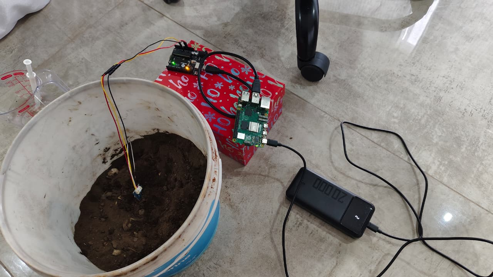
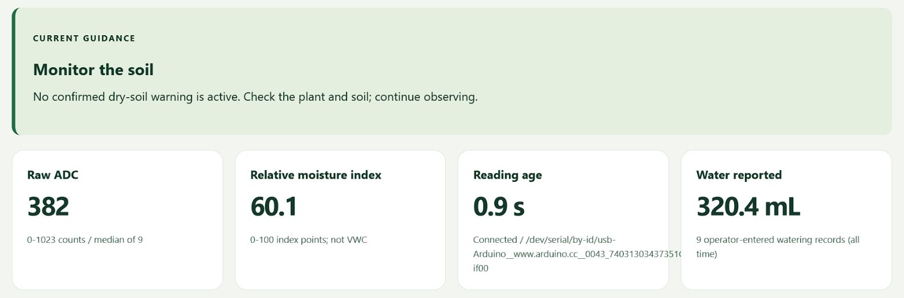

# Soil Moisture Monitoring and Water Quantity Prediction — Legacy Documentation

> **Earlier report-only copy.** The [current project repository](https://github.com/DarianRobert/Soil-Moisture-Monitoring) includes the Arduino firmware, Raspberry Pi dashboard, tests and original team history. This copy retains the earlier report and LaTeX source.

A university team IoT prototype that connects a **Grove Moisture Sensor v1.4**, **Arduino Uno** and **Raspberry Pi 5** to a browser dashboard. It monitors soil conditions, estimates a water quantity for a selected target and records the response to measured watering.

**[Read the project report](report/Soil_Moisture_Report.pdf)** · **[Report source](report/main.tex)**

## What the prototype does

- Reads the probe through the Uno's analogue input, filters groups of readings with a median and sends them to the Pi over USB serial.
- Converts readings to a calibrated relative moisture index and displays live status in a Flask dashboard.
- Uses separate warning and clearing thresholds, with an optional audible dry-soil alert.
- Estimates the water needed from recorded water-response curves and suggests a measured portion.
- Records manual water additions, monitoring history, prediction comparisons, and daily and weekly water-use summaries.

Water is added **manually** and recorded by the user. The prototype provides guidance and feedback; the report does not describe an automatic watering pump.

## Architecture and technologies

| Layer | Components |
| --- | --- |
| Sensing | Grove Moisture Sensor v1.4, Arduino Uno, analogue ADC readings |
| Communication | USB serial at 115200 baud; Wi-Fi/HTTP from the Pi to a browser |
| Processing and storage | Python, pySerial, SQLite |
| Dashboard | Flask served with Waitress |

Five retained fresh-soil trials supplied the prediction curves. In one reported dashboard example, the system estimated 5.9 mL and suggested a 2.0 mL portion. A separate check applied the final method to its saved baseline: the estimate was 6.1 mL, while 5.5 mL was added to reach the target. These are results for the documented setup, not a general accuracy guarantee across soils or plants.

## Available material

This repository contains the **project documentation** supplied for the portfolio: the compiled report, LaTeX source, references, architecture and wiring diagrams, experimental plots and prototype screenshots.

The Arduino sketch, Raspberry Pi application source, database and raw trial logs were not included in the supplied archive. This repository therefore does not currently provide a runnable implementation.

| Path | Contents |
| --- | --- |
| [report/Soil_Moisture_Report.pdf](report/Soil_Moisture_Report.pdf) | Complete report, design, method, results and limitations |
| [report/main.tex](report/main.tex) | LaTeX report source |
| [report/figures](report/figures) | Hardware photos, dashboard screenshots, diagrams and results |
| [report/references.bib](report/references.bib) | Bibliography supplied with the report |

To rebuild with a LaTeX installation: from `report/`, run `latexmk -pdf -jobname=Soil_Moisture_Report main.tex`.

## My role

I am one of the five credited authors of this UKZN team project. This portfolio copy presents our shared report, design and prototype evidence.

## Team

Developed for **COMP717A: Contemporary Topics in Computer Science A**, University of KwaZulu-Natal, by **Keolin Naicker, Lokadi Naicker, Arjun Ramphal, Darian Robert and Ntethelelo Shabalala**.

This is a team project presented as part of Darian Robert's portfolio. Team credits and the supplied report content are preserved; student numbers were removed for public presentation.
